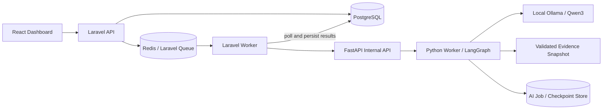

# GameScout AI — Proje Tanımı

> Durum: uygulanacak tasarım; çalışan ürün veya doğrulanmış veri sağlayıcı entegrasyonu iddiası değildir.
> Tarih: 13 Kasım 2026. Hedef kullanıcı: indie geliştiriciler ve küçük oyun ekipleri.

## Amaç ve ürün sınırı

GameScout AI, Android ve iOS oyunlarını seçilmiş bir araştırma kapsamında inceleyen, kanıt bağlantılarıyla pazar araştırması ve fırsat hipotezleri sunan bir market intelligence platformudur. Kullanıcı hangi verinin gözlem, hangisinin hesaplama ve hangisinin AI yorumu olduğunu görebilmelidir. Sistem oyun başarısını, indirme sayısını veya geliri tahmin etmiş gibi davranmaz.

İlk teslimat, sınırlı ve kaynağı bilinen bir veri kümesiyle uçtan uca çalışan bir portföy projesidir. Android ve iOS veri modelinde desteklenir; her iki platform için canlı ve kapsamlı veri erişimi MVP şartı değildir. Üretim erişimi, kaynak izinleri ve saha doğrulaması ayrı teslimatlardır.

## Yapılandırılabilir araştırma kapsamı

Her çalışma, sonradan değişmeyen bir kapsam anlık görüntüsü saklar:

| Alan | Örnek / davranış |
|---|---|
| Platform | `android`, `ios` veya ikisi |
| Ülke/storefront | Kullanıcının seçtiği ülke; veri bulunması garanti edilmez |
| Dil | Yorum dili ve rapor dili ayrı alanlar |
| Tür ve etiket | Kaynağın etiketleri ile iç normalizasyon ayrı tutulur |
| Tarih aralığı | Yayın tarihi, yorum tarihi ve gözlem tarihi ayrıştırılır |
| Geliştirici profili | Indie/küçük ekip filtresi; bilinmiyorsa `unknown`, AI ile kesin sınıflandırılmaz |
| Sınırlar | Oyun, yorum, çalışma süresi ve model çağrısı üst sınırları |
| Kaynaklar | Yalnızca etkin ve onaylanmış adaptörler |
| Sıklık | MVP'de elle başlatma; zamanlama sonraki aşama |

Önerilen demo sınırı: bir tür, bir ülke, 10–20 oyun, oyun başına en fazla 100 yorum ve bir eşzamanlı araştırma. Bunlar ürün kısıtlarıdır, piyasa istatistiği değildir. Başlangıç zaman bütçesi 10 dakika ve en fazla 20 model çağrısıdır; donanıma göre ölçülüp yapılandırılır. Limit dolarsa çalışma neden belirtilerek kısmi tamamlanır.

## Pragmatik MVP

### Dahil

1. Tek kullanıcıya uygun oturum açma ve kullanıcıya ait araştırmalar.
2. Kapsam formu, doğrulama, asenkron başlatma ve durum izleme.
3. Şeması doğrulanan JSON/CSV içe aktarımı; gerçek veride kaynak, izin ve tarih bilgisi zorunlu.
4. Discovery, Trend, Review ve Opportunity rollerinden oluşan sıralı LangGraph akışı.
5. Kanıt bağlantılı rapor, veri eksikleri, sınırlılıklar ve JSON/Markdown dışa aktarımı.
6. Tekrarlı istek güvenliği, hata/kısmi sonuç durumu, yapılandırılmış günlükler ve temel CI.
7. Docker ile yerel servisler; yerel Ollama üzerinde Qwen3.

### Sonraya bırakılanlar

Kapsamlı mağaza taraması, gerçek zamanlı izleme, ücretli veri satın alma, gelir/indirme tahminleri, çok kiracılı SaaS, otomatik oyun üretimi/yayınlama, karmaşık puanlama, otomatik model eğitimi ve genel amaçlı otonom web gezinme.

İlk çalışan dikey dilim: kaynaklı dosya → normalize edilmiş oyunlar/yorumlar → sınırlı araştırma → kanıtlı rapor → dashboard. Trend Agent ilk günden vardır; karşılaştırılabilir tarihli gözlem yoksa `insufficient_data` döndürür. Veri eksikliği başarılı bir şekilde bildirilebilir; uydurulmuş içerikle doldurulmaz.

## Teknoloji ve servis sınırları

| Bileşen | Sorumluluk |
|---|---|
| React + TypeScript | Kapsam formu, çalışma durumu, rapor ve kanıt ekranı |
| Laravel / PHP | Kimlik, yetkilendirme, iş kuralları, içe aktarım, kalıcı kayıtlar ve dış API |
| Python / FastAPI | İç AI iş API'si, Pydantic sözleşmeleri, LangGraph ve model adaptörü |
| Ollama / Qwen3 | Yerel çıkarım; başlangıç adayı Qwen3 8B, kesin model etiketi/digest kurulumda doğrulanır |
| PostgreSQL | İş verileri, gözlemler, rapor sürümleri, denetim ve kalıcı iş durumları |
| pgvector | İleride kanıt getirme/benzerlik; ilk rapor akışının bağımlılığı değildir |
| Redis | Laravel kuyruğu, kısa ömürlü kilitler ve cache; gerçek veri kaynağı değildir |
| Docker Compose | Yerel ağ, servisler, sağlık kontrolleri ve kalıcı diskler |
| GitHub Actions | Lint, tip kontrolü, test, sözleşme ve bağımlılık kontrolleri |

Framework ve runtime sürümleri kurulumda uyumlu set olarak seçilir; lockfile ve container etiketleri sabitlenir. Buradaki seçimler belirli bir sürümün davranışını garanti etmez. Qwen3'ün görev doğruluğu, JSON uyumu, gecikmesi ve RAM/VRAM ihtiyacı yerel donanımda ölçülmelidir. Yerel çıkarım ücretli model API'sini gerektirmez; donanım, enerji ve veri edinme maliyetleri yine vardır. Qwen3 rapor modelidir; embedding modeli ayrıca seçilir.

### Uzun süren işlerin yürütülmesi

Laravel bir araştırma ve dispatch kaydı oluşturur; commit sonrası Redis kuyruğuna iş gönderir. Kuyruk yayınlama hatalarını yeniden gönderen uzlaştırma görevi bulunur. Laravel Worker iç FastAPI'ye `research_id` ve aynı değişmez kapsam/kanıt snapshot referansı ile idempotent iş talebi gönderir. Redis'teki PHP job payload'ı Python tarafından okunmaz.

FastAPI işi kalıcı AI job tablosuna kaydettikten sonra `202` ve `job_id` döndürür. Ayrı Python worker, kalıcı iş tablosundan lease ile iş alır; uzun araştırma HTTP request içinde veya yalnızca FastAPI background task belleğinde çalışmaz. İş oluşturma tekrarlandığında aynı idempotency anahtarı aynı işi döndürür; aynı anahtarla farklı içerik `409` olur.

Laravel gecikmeli kısa polling işleriyle durumu okur; bir worker'ı uzun süre bekletmez. Python yalnızca AI şeması/checkpoint tablolarının sahibidir; Laravel iş tablolarına doğrudan yazmaz. Laravel doğrulanmış sonucu transaction ile rapor sürümü olarak kaydeder. Her iki katman migration'larını ayrı sahiplenir. MVP'de aynı PostgreSQL sunucusu, ayrı şema ve yetkili roller kullanılabilir.

Teslim garantisi “exactly once” değildir. Yinelenen teslim, timeout sonrası belirsiz durum ve yeniden başlatma beklenir; benzersiz anahtarlar, lease/heartbeat, checkpoint ve idempotent yazımlar kullanılır. AI bitmiş ama Laravel sonucu kaydedememişse aynı job sonucunu yeniden alarak toparlanır.

## LangGraph ve ajan rolleri

Orkestratör bir LLM başkan değil, durum geçişlerini yöneten kod tabanlı denetleyicidir. MVP sıralıdır; bağımsız dalları paralelleştirme ölçüm sonrası yapılır.

`validate_scope → load_evidence → discovery → trend → review → opportunity → validate_report → persist_result`

| Rol | Girdi | Çıktı ve sınır |
|---|---|---|
| Discovery | Kapsam ve izinli adaptör sonuçları | Kaynak ID'li normalize oyun listesi; yeni oyun veya sayı uyduramaz |
| Trend | Tarihli ve karşılaştırılabilir gözlemler | Kodla hesaplanan farklar ve sınırlı açıklama; tek snapshot ile trend yok |
| Review | Örneklem bilgili yorumlar | Temalar, destekleyen yorum ID'leri, çelişkiler ve örneklem sınırları |
| Opportunity | Doğrulanmış bulgular ve kısıtlar | Kanıta bağlı fırsat hipotezleri, karşı kanıt, risk ve doğrulama deneyi |

Discovery'nin filtreleme ve tekilleştirmesi deterministik kod olabilir; her role LLM çağrısı zorunlu değildir. Review temaları bir arada bulunabilir; yüzdelerin toplamı zorunlu olarak 100 değildir. Dil ve örnekleme yanlılığı raporda görünür olur. Opportunity çıktısı yatırım veya başarı garantisi değildir.

Ortak state: `research_id`, `schema_version`, `scope_snapshot`, `evidence_snapshot_id`, `node_statuses`, `findings`, `warnings`, `errors`, `call_budget`, `deadline`, `model_digest`, `prompt_version`, `graph_version`. Büyük ham içerikler yerine ID/referans taşınır. Checkpoint kalıcılığı açıkça yapılandırılır ve yeniden başlatma testiyle doğrulanır; framework tek başına güvenilir teslim garantisi sayılmaz.

Geçersiz model çıktısı en fazla bir onarım denemesi alır. Geçici ağ hataları en fazla iki yeniden deneme, jitter/backoff ve ortak deadline ile sınırlıdır. Yetki, şema veya izin hataları tekrar denenmez. Kullanıcı iptali düğüm ve model çağrısı sınırlarında kontrol edilir; çalışan çağrı anında durdurulamıyorsa durum açıkça gösterilir.

## Veri edinme ve kaynak doğrulama

MVP'nin garanti edilen veri yolu kontrollü dosya içe aktarımıdır. Gerçek veri, kullanma hakkı ve kaynak bilgisiyle gelir. Sentetik fixture'lar `synthetic_demo` olarak ayrı etiketlenir; gerçek pazar kanıtı olarak raporlanmaz. İçe aktarım, verinin doğruluğu veya kullanım hakkını tek başına kanıtlamaz.

| Kaynak adayı | Planlanan yaklaşım / belirsizlik |
|---|---|
| Android/iOS metadata | Uygun resmi veya lisanslı kaynak adaptörü değerlendirilecek; kapsam ve alanlar henüz garanti değil |
| Rakip oyun yorumları | Kamuya açık sınırsız bir resmi API varsayılmaz; izinli veri seti veya lisanslı sağlayıcı gerekebilir |
| Geliştiricinin kendi oyun verileri | Hesap yetkisi ve ilgili API kapsamı doğrulanarak ayrı adaptör |
| Ücretli intelligence sağlayıcısı | Sözleşme, maliyet, yeniden dağıtım ve alan kapsamı değerlendirilmeden etkinleştirilmez |

Apple'ın Customer Reviews dokümanı kendi uygulamanızın yorumlarını okumayı anlatır; bunu tüm rakip oyunların yorumlarına erişim olarak yorumlamayın ([resmi belge](https://developer.apple.com/documentation/appstoreconnectapi/customer-reviews)). Google Play veya Apple için bu tasarımda rakip indirme/gelir verisi garantisi yoktur.

Her adaptör için `docs/sources/<provider>.md`: resmi belge URL'si, kontrol tarihi, erişim yöntemi, yetkiler, alanlar, ülke/dil kapsamı, kota, saklama/yeniden kullanım koşulları ve gerçek örnek cevap kaydedilir. İzin verilmemiş scraping, erişim kontrolü aşma veya kota atlatma uygulanmaz. Kaynak kullanılamıyorsa sonuç açıkça eksik kalır.

## Veri modeli ve kanıt sözleşmesi

- `games`: iç kimlik; `platform + external_app_id` benzersizliği. Android/iOS sürümleri ancak doğrulanmış eşleştirmeyle ilişkilendirilir.
- `source_records`: sağlayıcı, dış kayıt ID'si/URL veya dosya hash'i ve satır konumu, erişim/izin referansı, checksum ve import batch.
- `game_observations`: oyun, ülke, dil, gözlem zamanı, kaynak zamanı, metrik adı/değeri/birimi ve evidence ID. Null, sıfır değildir.
- `reviews`: kaynak yorum ID'si, oyun, dil, rating ölçeği, yayın/güncelleme tarihi ve izin verilen içerik. Kullanıcı kimlikleri mümkün olduğunca tutulmaz.
- `researches`, `research_events`, `reports`, `findings`, `evidence_links`: kullanıcı sahipliği, kapsam, durum, sürüm ve kanıt ilişkileri.
- AI şeması: `ai_jobs`, lease/heartbeat, checkpoint ve idempotency kayıtları.
- İleri aşama `embeddings`: kaynak chunk ID'si, model/digest, boyut ve içerik hash'i. Embedding değişince yeniden indeksleme gerekir.

Her bulgu: `id`, `kind` (`observation|calculation|hypothesis`), `statement`, `evidence_ids`, `limitations`, `method_version`. Hesaplamalar ayrıca girdi ID'leri, formül, birim, pay/payda ve zaman aralığını taşır. Hipotezler doğrulama deneyi ve karşı kanıt içerir. Güven etiketleri olasılık değildir; kuralları açıklanmamış sayısal confidence üretilmez.

Kaynak zamanı bilinmiyorsa null bırakılır; içe aktarım zamanı yayın zamanı yerine kullanılmaz. UTC saklanır, arayüz saat dilimine çevrilir. Rapor kaynak listesi, çekilme tarihi, örneklem büyüklüğü, kapsanmayan alanlar ve güncellik uyarısı içerir. Saklama süresi kaynağın koşullarına göre belirlenir; ham içerik kalıcı saklanmak zorunda değildir, izin varsa hash ve referans tutulur.

### Sayı ve trend kuralları

- LLM; indirme, gelir, retention, DAU, pazar payı veya büyüme sayısı üretmez.
- Kaynak indirme aralığı veriyorsa aralık korunur; kesin sayıya çevrilmez.
- Rating sayısı, yazılı yorum sayısı ve indirilmeler farklı alanlardır.
- Trend için aynı metrik, platform, ülke, ölçek ve yöntemle en az iki ayrı zaman gözlemi gerekir; iki nokta yalnızca dönemsel değişim gösterir, uzun vadeli trend kanıtı değildir.
- `(yeni - eski) / eski * 100` yalnızca karşılaştırılabilir değerlerde ve eski değer sıfır değilse hesaplanır. Eksik kapsam, sıfır taban veya metodoloji değişimi açıklanır.
- Yorum teması oranı yalnızca incelenen örneklem üzerindendir; tüm oyunculara genellenmez. Tekilleştirme, seçilme yöntemi ve payda gösterilir.
- Ölçülmüş veri, sağlayıcı tahmini ve AI hipotezi ayrı etiketlenir. Sağlayıcı tahmini gerçek gözlem gibi sunulmaz.
- Bir citation ID'nin varlığı yeterli değildir: kaynak metnin iddiayı desteklediği de doğrulanır. Otomatik kontrolün anlam doğrulaması sınırlıysa rapor inceleme gerektirir.

## Önerilen API sözleşmesi

Bunlar uygulanacak uygulama uçlarıdır; hazır framework veya mağaza API yetenekleri değildir.

| Uç | Amaç |
|---|---|
| `POST /api/v1/imports` | Boyut/şema/izin bilgisi kontrol edilen veri yükleme |
| `POST /api/v1/researches` | `Idempotency-Key` ve kapsam ile `202` + çalışma kimliği |
| `GET /api/v1/researches/{id}` | Yetkili kullanıcı için durum ve düğüm ilerlemesi |
| `POST /api/v1/researches/{id}/cancel` | İdempotent iptal talebi |
| `GET /api/v1/researches/{id}/report` | Hazır rapor ve sürümü; henüz yoksa açık durum hatası |
| `GET /api/v1/researches/{id}/export?format=json\|md` | Güvenli dosya dışa aktarımı |
| İç `POST /internal/v1/jobs` | Laravel'den doğrulanmış snapshot ile AI işi oluşturma |
| İç `GET /internal/v1/jobs/{id}` | Durum ve doğrulanmış sonuç |
| İç `POST /internal/v1/jobs/{id}/cancel` | AI katmanına iptal talebi |

Durumlar: `queued`, `running`, `completed`, `partial`, `failed`, `cancelled`. `completed` çıktısının veri kalitesi ayrıca değerlendirilir; terminal durumlar yanlışlıkla tekrar `running` yapılmaz. Kritik içe aktarım/kanıt doğrulaması başarısızsa `failed`; yalnızca bir analiz veri yetersizliğinden atlandıysa gerekçeli `partial`. Hatalar kod ve correlation ID içerir, stack trace istemciye verilmez.

## Güvenlik ve işletim

Laravel sahiplik politikalarını her uçta uygular. Cookie oturumunda CSRF ve dar CORS/origin ayarı kullanılır. FastAPI, Redis, PostgreSQL ve Ollama internete açılmaz; servisler arası kimlik doğrulama ve en az yetkili roller kullanılır. Remote erişim gerekiyorsa TLS ve kontrollü ağ erişimi gerekir.

Kaynak URL'leri allowlist üzerinden sunucuda üretilir; kullanıcı URL'si doğrudan fetch edilmez. Redirect, private/link-local IP ve DNS rebinding riskleri kontrol edilir. Yüklemelerde boyut, satır, MIME, şema, Unicode ve içerik uzunluğu sınırları uygulanır. CSV dışa aktarımı eklenirse formula injection engellenir. Markdown/HTML raporları sanitize edilir.

Yorumlar ve kaynak metinler güvenilmeyen veridir: içlerindeki talimatlar system prompt olamaz, araç yetkisi veremez. Agent keyfi shell, SQL veya sınırsız HTTP aracı kullanmaz. Secret'lar promptlara, raporlara, loglara veya Git'e girmez. İnceleme metninden kişisel veri minimize edilir; silme, saklama ve kaynak lisansına bağlı türev veri temizliği tasarlanır.

Loglar `research_id`, job/node, süre, retry, model/digest ve hata kodu taşır; ham yorumlar ve chain-of-thought kaydedilmez. Readiness bağımlılık durumunu yansıtır. DB/checkpoint yedeği ve restore denemesi üretim öncesi şarttır; Redis kaybında kalıcı iş kayıtlarından uzlaştırma yapılır.

## Uygulama aşamaları ve kabul ölçütleri

| Aşama | Teslimat | Bitti koşulu |
|---|---|---|
| 0 — Kararlar | Repo iskeleti, ADR'ler, sözleşmeler, kaynak kayıt şablonu | Sürüm/model seçimi ve veri hakkı belirsizlikleri yazılı |
| 1 — Kanıt omurgası | Migration, içe aktarım, normalize veri, demo fixture | Hatalı dosya reddedilir; gerçek/sentetik ayrımı ve dedup testli |
| 2 — Dikey dilim | Laravel job → kalıcı Python job → Discovery → rapor → React | Bir kullanıcı fixture ile raporu uçtan uca görebilir |
| 3 — Analiz | Trend, Review, Opportunity ve rapor doğrulayıcı | Yetersiz veride çekimserlik; her gerçek iddiaya geçerli kanıt |
| 4 — Dayanıklılık | Retry, iptal, checkpoint, sahiplik ve CI | Tekrarlı istek/worker restart çift rapor yaratmaz; yetkisiz erişim reddedilir |
| 5 — İsteğe bağlı canlı kaynak | Tek doğrulanmış adaptör ve kaynak kaydı | Gerçek cevap fixture'ı, izin/kota ve hata davranışı belgeli |

Takvim taahhüdü yerine bu geçiş ölçütleri kullanılır. Küçük bağımsız pull request'ler tercih edilir. Demo hem başarılı raporu hem veri yetersizliği senaryosunu göstermelidir.

### Test stratejisi

PHP: kapsam ve yetki feature testleri, import/dedup ve idempotency testleri. Python: deterministik analiz, graph geçişleri, model şema/kanıt doğrulaması, timeout/iptal ve checkpoint restart testleri. TypeScript: form doğrulama, durum/eksik veri bileşenleri ve bir uçtan uca rapor senaryosu.

Servisler arası şema sözleşme testleri, gerçek PostgreSQL/Redis ile entegrasyon testi ve sahte model/adaptörlerle CI çalıştırılır. Normal CI harici mağaza veya çalışan büyük modele bağımlı olmaz. Yerel Qwen3 smoke/evaluation ayrı opt-in testtir; gerçek model testi yapılmadıysa sonuç açıkça yazılır.

Küçük etiketlenmiş değerlendirme kümesi; kaynak eşleşmesi, desteklenmeyen iddialar, temaların doğruluğu, çekimserlik, çıktı şeması ve gecikmeyi ölçer. Yayın kapısı: şema dışı rapor yayınlanmaz; referanssız gerçek iddialar ve kaynaksız sayılar test kümesinde sıfır olmalıdır. Bu eşik gerçek dünyada kusursuz doğruluk garantisi değildir.

## Gelecekte AI Game Studio entegrasyonu

GameScout araştırma bağlamını ve kanıtlı tasarım hipotezlerini üretir; Game Studio ayrı bir üretim sistemidir. İlk köprü sürümlenmiş `OpportunityBrief v1` JSON dışa aktarımıdır: `brief_id`, `report_id/version`, `schema_version`, hedef oyuncu, problem/tema, kanıt ID'leri, kapsam/tarih, hipotez, risk, karşı kanıt, önerilen deney ve kullanım hakları.

Kullanıcı bir hipotezi seçtikten sonra brief aktarılır. Studio'nun kod/asset üretimi, telif değerlendirmesi, bütçe kullanımı, test ve mağazaya yayınlama yetkileri ayrı onay ve güvenlik sınırlarıdır. Araştırma ajanları bu yetkileri otomatik edinmez. Türev veriye aktarım hakkı olmayan ham yorumlar dışa aktarılmaz; kaynak referansları ve izinli özetler kullanılır.

Sonraki adım event/outbox tabanlı `opportunity.brief.approved.v1` olabilir; retry ve consumer idempotency gerekir. MVP'ye event bus, Studio runtime veya oyun motoru bağımlılığı eklenmez. Studio deney sonuçları ileride hipotezlerle ilişkilendirilir; başarı sonucu eski raporun kanıtlarını geriye dönük değiştirmez.

## Teknik doğrulama kaynakları

13 Kasım 2026 tarihinde kontrol edilen başlangıç referansları; uygulama öncesi seçilen sürümle yeniden doğrulanmalıdır:

- [Apple — Customer Reviews](https://developer.apple.com/documentation/appstoreconnectapi/customer-reviews): kendi uygulamasının yorumlarına ilişkin kapsam.
- [Ollama — Structured outputs](https://ollama.com/blog/structured-outputs): JSON Schema ile çıktı kısıtlama yaklaşımı. Bu özellik kanıt doğruluğunu garanti etmez; uygulama tarafı doğrulama zorunludur.
- [LangGraph resmi kaynak — Graph API](https://github.com/langchain-ai/docs/blob/main/src/oss/langgraph/graph-api.mdx): state/node yapısı ve yeniden yürütmede idempotency hususları.

Uygulama ajanı kuralları: [AGENTS.md](AGENTS.md).
